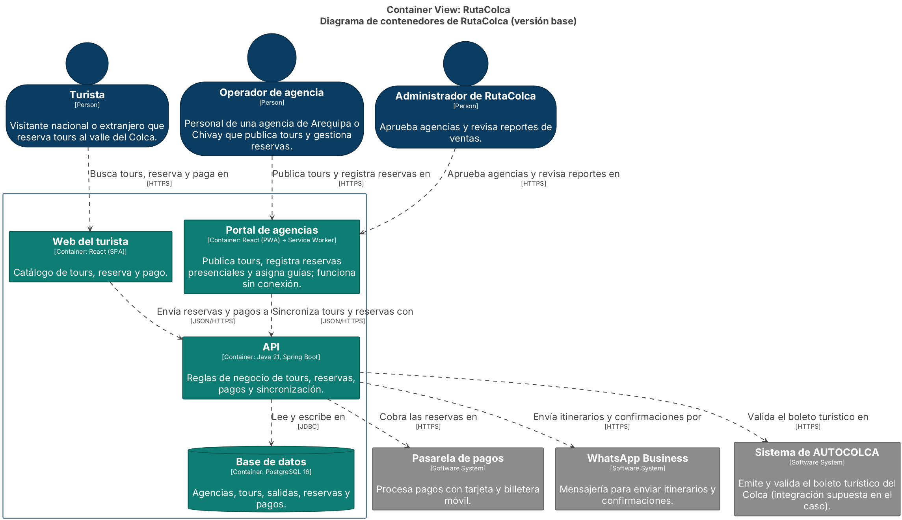
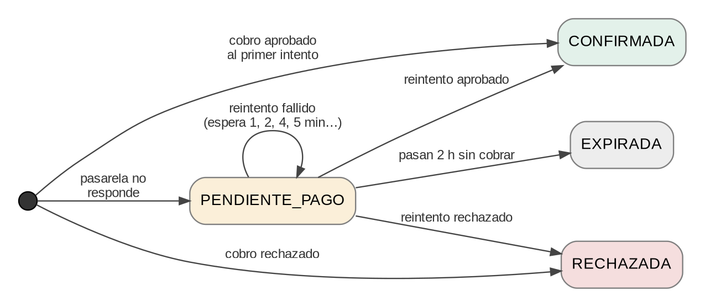
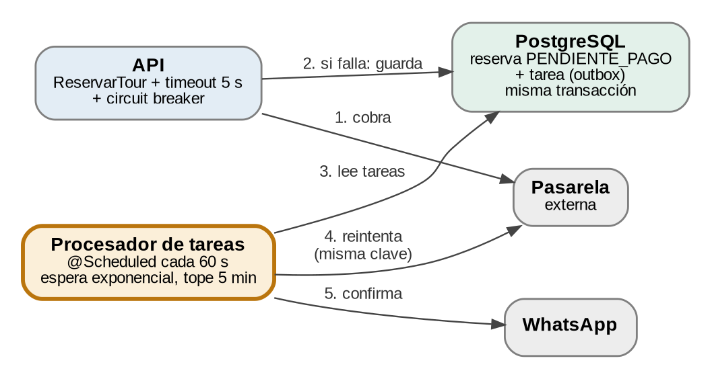
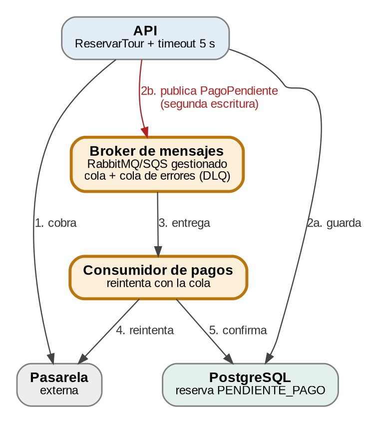

# AG-10 · Alternativas de diseño (iteración de ADD · escenario E2)

## Paso 3. Iteración de ADD

**Tabla 8. Pasos de ADD aplicados al caso.**

| Paso ADD | Qué hacen en AG-10 | Lo que hicimos en E2 |
| --- | --- | --- |
| 2. Objetivo de la iteración | Cumplir la medida de su escenario sin romper los demás. | Lograr 0 reservas pagadas perdidas y confirmación ≤ 30 min cuando la pasarela cae, sin empeorar E1, E3, E4 ni E5. |
| 3. Elementos a refinar | Qué contenedor o componente de la Figura 1 cambia (p. ej., la API, el módulo Pagos). | La API (módulo de pagos: ReservarTour y un adaptador de la pasarela) y la base de datos (tabla de tareas). Aparece un contenedor nuevo, el Procesador de tareas. |
| 4. Conceptos de diseño | Tácticas (Anexo A) y patrones (Tema 10) que podrían lograr la medida. | Tácticas de disponibilidad: tiempo de espera y monitoreo (detectar), reintento y degradación (recuperarse), transacciones (prevenir). Patrones: puertos y adaptadores (ya existente), outbox transaccional, circuit breaker e idempotencia. |
| 5. Instanciar | Elementos nuevos o modificados, sus responsabilidades e interfaces. | Ver la Tabla 8b. |

*Arquitectura de partida (solución de AG-08): la API llama de forma síncrona a la pasarela, a WhatsApp y a AUTOCOLCA.*

Lo primero que vimos en la Figura 1 es que la flecha **API → Pasarela de pagos** es síncrona y no tiene ninguna defensa: sin límite de espera, sin reintento y sin dónde guardar la reserva. Con la pasarela caída, cada petición se queda colgada hasta que alguien aborta, los hilos de la API se van ocupando y, como el catálogo comparte esos mismos hilos, también se resiente E1. Por eso la iteración se centra en ese punto y no en otros.

**Tabla 8b. Elementos nuevos o modificados (paso 5 de ADD).**

| Elemento | Cambio | Responsabilidad | Interfaz |
| --- | --- | --- | --- |
| AdaptadorPasarela | Nuevo | Implementa el puerto PasarelaPago con timeout de 5 s, circuit breaker (Resilience4j) y clave de idempotencia. | `cobrar(clave, monto)` → APROBADO / RECHAZADO; lanza PasarelaNoDisponibleException. |
| ReservarTour | Modificado | Cobra; si la pasarela falla, deja la reserva PENDIENTE_PAGO y registra la tarea en la misma transacción. | `ejecutar(reservaId, monto)` → Reserva. |
| RepositorioOutbox | Nuevo | Guarda reserva y tarea de forma atómica y entrega las tareas vencidas. | `guardarAtomico(reserva, tarea)`, `tareasVencidas(ahora)`. |
| ReservasController | Modificado | Responde 201 si el cobro se aprobó y 202 si quedó en proceso. | `POST /reservas`. |
| Procesador de tareas | Nuevo (contenedor) | Cada 60 s reintenta los cobros pendientes con espera 1, 2, 4 y 5 min (tope), confirma y avisa por WhatsApp. Tras 2 h sin cobrar, la reserva expira. | `@Scheduled`; consulta con `FOR UPDATE SKIP LOCKED`. |
| Base de datos | Modificada | Tabla `tarea_pago` (reserva, intentos, próximo intento, estado) con índice parcial; la reserva gana los estados PENDIENTE_PAGO y EXPIRADA. | JDBC / JPA. |

*Estados de una reserva en el flujo de pago.*

### Comparación de alternativas

**Tabla 9. Comparación de alternativas.**

| Criterio | Alternativa A | Alternativa B |
| --- | --- | --- |
| Tácticas | Detectar fallas: tiempo de espera (5 s) y monitoreo (tareas pendientes). Recuperarse: reintento con espera exponencial y degradación (reserva pendiente). Prevenir: transacción (reserva + tarea). | Detectar fallas: tiempo de espera. Recuperarse: reintento (reentrega de la cola), redundancia (broker gestionado) y degradación. Prevenir: transacción solo parcial, porque son dos escrituras distintas. |
| Patrón o tecnología | Outbox transaccional + circuit breaker (Resilience4j) + clave de idempotencia. Procesador `@Scheduled` del mismo código (perfil worker) sobre PostgreSQL con `SKIP LOCKED`. | Mensajería asíncrona con una cola (RabbitMQ o Amazon SQS gestionado), cola de mensajes fallidos (DLQ) y un consumidor de pagos. |
| Cómo logra la medida | 0 perdidas: la reserva y la tarea se guardan juntas, no existe un instante en que una exista sin la otra. Confirmación ≤ 30 min: sondeo de 60 s y tope de espera de 5 min; en el peor caso ≈ 6 min tras la recuperación. | 0 perdidas solo si la publicación del mensaje nunca falla; para garantizarlo habría que añadir también una outbox (o sea, A más la cola). Confirmación: la entrega es casi inmediata al recuperarse la pasarela. |
| Costo (desarrollo y operación) | Desarrollo ≈ 9 días-persona (adaptador 2, outbox y tabla 2, procesador 2, controlador 1, pruebas 2). Operación: sin infraestructura nueva; el procesador usa las mismas 2 VM y PostgreSQL (≈ US$ 0 adicionales; ≈ 0,5 GB de RAM más por VM). | Desarrollo ≈ 14–16 días-persona (broker, cliente, consumidor, DLQ, outbox para evitar la doble escritura, pruebas). Operación: broker gestionado, estimado desde US$ 20–60 al mes, más monitoreo y aprender a operar un componente nuevo. |
| Riesgos | El sondeo agrega una consulta por minuto a PostgreSQL (baja, con índice). La latencia mínima de reintento es 1 min. Si el procesador se detiene, las tareas esperan (mitigación: 2 instancias y alerta si la tarea más antigua supera 10 min). | Doble escritura: si falla la publicación después de guardar la reserva, queda una reserva sin tarea. Otra pieza que puede caerse. El equipo no tiene experiencia operando brokers y el plazo de 3 semanas queda ajustado. |
| ¿Respeta las restricciones? | Sí. Mantiene el monolito modular (ADR-001), usa las tecnologías aprobadas, cabe en 3 semanas con 4 personas y no agrega infraestructura que justificar. | Parcialmente. Mantiene el monolito, pero agrega infraestructura nueva cuyo costo de operación habría que justificar y el broker no figura entre las tecnologías del caso. |

**Nota:** las cifras de días-persona y de costo mensual son estimaciones nuestras, no cotizaciones; sirven para comparar y habría que validarlas antes de comprometerse.

*Alternativa A: outbox transaccional y procesador de tareas.*

*Alternativa B: cola de mensajes. La doble escritura (2a y 2b) es su punto débil.*

#### Qué descartamos y por qué

También descartamos explícitamente dos ideas que suelen aparecer primero. Un **microservicio de pagos** habría roto el ADR-001 para resolver el problema de un solo módulo. Y una **caché** no ayuda aquí: acelera lecturas, pero el problema de E2 es la disponibilidad de un sistema externo, así que no mejora la medida del escenario.

Entre A y B elegimos **A**. La diferencia decisiva es que B termina necesitando una outbox igual para no perder reservas, así que paga el costo de A y además el de operar un broker. A cumple la medida con lo que ya tenemos.
