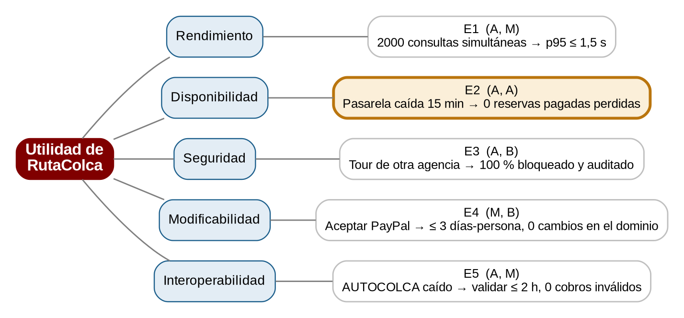
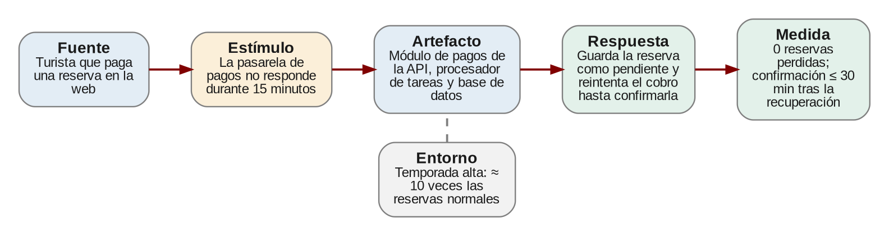

# AG-10 · Árbol de utilidad y escenario completo

Grupo: 4 · Escenario asignado: **E2 · Disponibilidad** · Fecha: 31/10/2026

## Paso 1. Priorizar con un árbol de utilidad

**Tabla 6. Árbol de utilidad en forma de tabla.**

| Escenario | Importancia (A/M/B) | Dificultad (A/M/B) | Justificación (una línea) |
| --- | --- | --- | --- |
| E1 Rendimiento | A | M | La venta de julio depende de que el catálogo responda; son lecturas y una caché más las réplicas lo cubren sin rediseñar. |
| E2 Disponibilidad | A | A | Cada cobro perdido es dinero y confianza; hoy la API cobra de forma síncrona y, si la pasarela falla, no guarda nada. |
| E3 Seguridad | A | B | Exponer datos de otra agencia es grave, pero se cierra verificando el dueño del tour en cada petición. |
| E4 Modificabilidad | M | B | PayPal es deseable, no urgente; con el puerto PasarelaPago basta un adaptador nuevo. |
| E5 Interoperabilidad | A | M | Cobrar un boleto inválido genera reclamos, y AUTOCOLCA es un sistema que no controlamos. |



*Árbol de utilidad de RutaColca. El único escenario (A, A) es E2, resaltado en naranja.*

#### Cómo calificamos

Para calificar usamos dos preguntas simples. Sobre la importancia: ¿qué pasa con el negocio si esto falla en julio? Sobre la dificultad: ¿cuánto nos cuesta lograrlo con la arquitectura de la Figura 1 sin romper el monolito modular (ADR-001) y con 4 desarrolladores en 3 semanas?

Casi todo resultó importante (cuatro de cinco en A), así que lo que realmente separó a los escenarios fue la dificultad. E3 y E4 importan, pero se resuelven con lo que ya tenemos: una verificación de propiedad por objeto y un adaptador nuevo detrás de un puerto. E1 y E5 quedaron en dificultad media. Solo **E2 quedó en (A, A)**: es el escenario que más riesgo concentra, porque hoy no existe ningún mecanismo que guarde el trabajo cuando la pasarela falla.

#### Qué nos falta saber (revisión con el prompt P1)

Al revisar la tabla surgieron preguntas que no podemos responder solo con el enunciado. Las dejamos anotadas como supuestos de trabajo:

- **E1:** ¿cuál es el p95 actual y cuántas consultas por segundo soporta hoy PostgreSQL? Supusimos que con la caché de 30 s alcanza, pero habría que medirlo.
- **E2:** ¿la pasarela real acepta una clave de idempotencia o permite consultar el estado de un cobro? Supusimos que sí; si no, el riesgo de doble cobro sube (ver evaluación, riesgo R1).
- **E3:** ¿el token de sesión incluye la agencia del operador? Supusimos que sí; por eso dejamos E3 en dificultad baja.
- **E5:** ¿qué ocurre si AUTOCOLCA invalida un boleto después de haber cobrado? El caso no lo dice; no lo resolvemos en esta iteración.

## Paso 2. Completar el escenario asignado

**Tabla 7. Escenario completo (E2 · Disponibilidad).**

| Parte | Contenido del grupo |
| --- | --- |
| Fuente | Turista que paga una reserva desde la web (el hecho que dispara el problema es la pasarela de pagos externa, que deja de responder). |
| Estímulo | La pasarela de pagos no responde durante 15 minutos mientras siguen llegando solicitudes de pago. |
| Artefacto | Módulo de pagos de la API (caso de uso ReservarTour y adaptador de la pasarela), procesador de tareas y base de datos. |
| Entorno | Temporada alta: unas 10 veces las reservas habituales, con las 2 réplicas de la API funcionando y los demás sistemas externos disponibles. |
| Respuesta | La API corta la espera, guarda la reserva en estado PENDIENTE_PAGO junto con una tarea de cobro (en una sola transacción) y avisa al turista que su pago está en proceso. El procesador reintenta el cobro con la misma clave de idempotencia; al aprobarse, confirma la reserva y envía la confirmación por WhatsApp. |
| Medida de respuesta | 0 reservas pagadas perdidas. Confirmación ≤ 30 min tras la recuperación de la pasarela. 0 cobros duplicados. Respuesta de la API al turista ≤ 6 s aun con la pasarela caída (timeout de 5 s + escritura en BD). |



*Escenario E2 con sus seis partes.*

#### Por qué esta medida sí se puede verificar

Reescribimos la medida del enunciado para que cada número tenga una forma concreta de comprobarse:

- **0 reservas perdidas** y **0 cobros duplicados**: se cuentan en la prueba automatizada con la pasarela simulada (Paso 7). En producción, un reporte compara reservas creadas contra reservas en estado final.
- **Confirmación ≤ 30 min**: la prueba avanza un reloj simulado 15 minutos de caída y mide cuánto tarda cada reserva en confirmarse después de la recuperación. En producción se vigila la métrica «edad de la tarea pendiente más antigua».
- **Respuesta ≤ 6 s**: se mide con la pasarela en modo lento; la prueba comprueba que la API no espera más que el timeout configurado.

Añadimos las dos últimas medidas (0 duplicados y ≤ 6 s) porque sin ellas se podría «cumplir» el escenario cobrando dos veces o dejando al turista esperando.

#### Plantilla del Anexo B

```
ID: E2   Atributo: Disponibilidad
Fuente:    turista que paga una reserva desde la web
Estímulo:  la pasarela de pagos no responde durante 15 minutos
Artefacto: módulo de pagos de la API, procesador de tareas y base de datos
Entorno:   temporada alta (≈ 10x reservas), 2 réplicas de la API operativas
Respuesta: guardar la reserva como PENDIENTE_PAGO + tarea (1 transacción),
           reintentar el cobro con la misma clave, confirmar y avisar por WhatsApp
Medida:    0 reservas pagadas perdidas; confirmación <= 30 min tras la recuperación;
           0 cobros duplicados; respuesta de la API <= 6 s con la pasarela caída
```
